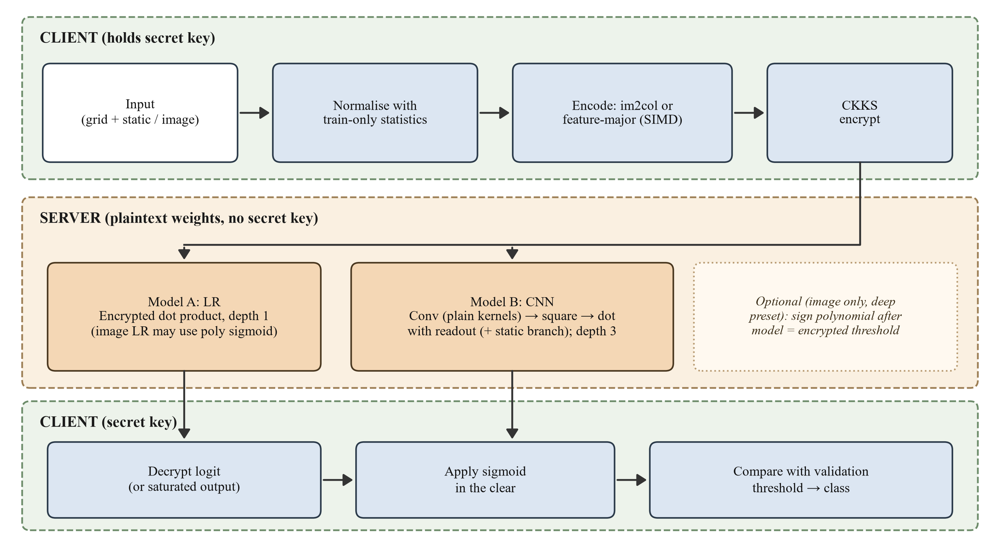

# Benchmarking Linear and Convolutional Models Under CKKS Homomorphic Encryption

Codebase, experimental reproduction suite, and research paper for:  
**"Benchmarking Linear and Convolutional Models Under CKKS Homomorphic Encryption: Trade-Offs in Latency, Accuracy, and Decision Fidelity Across Tabular and Image Clinical Tasks"**  
Authors: **Dr. Maroti Deshmukh, Swaraj Singh Pal, and Sharad Gupta** (Department of Computer Science and Engineering, National Institute of Technology Uttarakhand).  
Research paper: [`report/paper.pdf`](report/paper.pdf) | [`report/paper.docx`](report/paper.docx) | [`report/paper.tex`](report/paper.tex).  
Minor project report: [`docs/SHARAD_GUPTA_BT24CSE030_MINOR_PROJECT_REPORT.pdf`](docs/SHARAD_GUPTA_BT24CSE030_MINOR_PROJECT_REPORT.pdf).

---

## Abstract

Machine-learning inference on sensitive medical data requires that neither the patient's record nor the prediction is exposed to the party hosting the model. Homomorphic encryption makes this possible under the Cheon–Kim–Kim–Song (CKKS) scheme, but restricts algebraic operations to additions and multiplications and introduces cumulative approximation noise across circuit layers. This project develops and benchmarks a unified CKKS client–server inference framework (implemented with TenSEAL and Microsoft SEAL) comparing linear logistic regression (LR) and shallow depth-three square-activation convolutional neural networks (CNNs) across two independent clinical modalities without data fusion:
1. **Clinical Tabular Time-Series**: In-hospital length-of-stay ($\text{LOS} > 7$ days) prediction on MIMIC-III (22,536 stays) and MIMIC-IV (35,794 stays) using hybrid 2D-convolution grids ($12 \times 10$ and $12 \times 5$) plus static feature branches.
2. **Pathology Cell Images**: Single-cell malaria parasite detection on 27,558 Giemsa-stained thin blood smear images from NIH using a 457-parameter CNN and 785-parameter LR.
3. **High-Throughput SIMD Batching & Encrypted Thresholding**: Feature-major SIMD batch packing (up to 8,192 images per ciphertext without slot rotations) and server-side iterative sign-polynomial decision evaluation.

On microscopic images, the CNN delivers a decisive diagnostic gain ($+0.050$ AUROC, $+0.103$ accuracy) at a modest $1.7\times$–$1.9\times$ latency overhead. On tabular ICU data, however, the CNN's AUROC gain is marginal ($+0.005$ to $+0.018$) despite a $3.1\times$–$4.8\times$ run-time penalty, making LR the preferred model. Feature-major SIMD batching reduces amortized per-image inference time to **1.01 ms** (LR) and **3.37 ms** (CNN) with zero test-split flips under standard CKKS parameters.

---

## Architecture

Two independent domain pipelines share a single, unified cryptographic inference engine (`common/`):

```
       +--------------------------------------------------------------+
       |                     CLIENT ENVIRONMENT                       |
       |  Raw Features / Images ---> im2col / SIMD Batch ---> Encrypt |
       +--------------------------------------------------------------+
                                      |
                           [Ciphertext Transmission]
                                      v
       +--------------------------------------------------------------+
       |                     SERVER ENVIRONMENT                       |
       |                   (Zero Plaintext Access)                    |
       |                                                              |
       |    [Ciphertext] ---> Encrypted 2D Conv (ct-pt mul & add)     |
       |                             |                                |
       |                             v                                |
       |                  Square Activation (ct-ct mul)               |
       |                             |                                |
       |                             v                                |
       |                  Linear Readout / Dot (ct-pt dot)            |
       |                             |                                |
       |    [Optional: Encrypted Sign Polynomial Iterations]          |
       +--------------------------------------------------------------+
                                      |
                        [Decrypted Result Payload]
                                      v
       +--------------------------------------------------------------+
       |                     CLIENT ENVIRONMENT                       |
       |  Decrypted Logit / Saturated Decision <--- Decrypt with SK   |
       +--------------------------------------------------------------+
```



---

## Verified Results (Matched to `report/paper.pdf` & JSON Logs)

### 1. Model Quality & Plaintext vs. Encrypted Fidelity (Held-Out Test Splits)

| Modality & Configuration | Model Architecture | Params | Plaintext AUROC | CKKS AUROC (Precise) | Plaintext Accuracy | Test Flips (Precise) | Test Flips (Standard) | Latency (Std / Prec) |
|---|---|---|---|---|---|---|---|---|
| **MIMIC-IV ($12 \times 10$)** | Hybrid CNN (4 ch, square) + static | 198 | **0.7852** | **0.7852** | 74.99% | **0** / 5,369 | 7 (0.13%) | 49 / 152 ms |
| **MIMIC-IV ($12 \times 10$)** | LR (grid + static) | 153 | 0.7741 | 0.7741 | 71.60% | 1 / 5,369 | 12 (0.22%) | 14 / 32 ms |
| **MIMIC-IV ($12 \times 5$)** | Hybrid CNN (4 ch, square) + static | 138 | 0.7049 | 0.7049 | 63.31% | **0** / 5,369 | 17 (0.32%) | 40 / 131 ms |
| **MIMIC-IV ($12 \times 5$)** | LR (grid + static) | 93 | 0.6874 | 0.6874 | 66.81% | **0** / 5,369 | 20 (0.37%) | 13 / 39 ms |
| **MIMIC-IV (Static Baseline)**| Logistic Regression (32 static) | 33 | 0.6569 | — | 51.72% | — | — | — |
| **MIMIC-III ($12 \times 10$)**| Hybrid CNN (4 ch, square) + static | 181 | 0.6924 | 0.6924 | 57.51% | **0** / 3,380 | 8 (0.24%) | 35 / 136 ms |
| **MIMIC-III ($12 \times 10$)**| LR (grid + static) | 136 | 0.6853 | 0.6853 | 68.85% | **0** / 3,380 | 6 (0.18%) | 10 / 31 ms |
| **MIMIC-III ($12 \times 5$)** | Hybrid CNN (4 ch, square) + static | 121 | 0.6417 | 0.6417 | 57.69% | **0** / 3,380 | 14 (0.41%) | 31 / 116 ms |
| **MIMIC-III ($12 \times 5$)** | LR (grid + static) | 76 | 0.6370 | 0.6370 | 57.66% | **0** / 3,380 | 6 (0.18%) | 10 / 30 ms |
| **MIMIC-III (Static Baseline)**| Logistic Regression (15 static) | 16 | 0.6037 | — | 34.50% | — | — | — |
| **NIH Malaria ($28 \times 28$)** | CNN (4 ch, $7 \times 7$, stride 3) | **457** | **0.8568** | **0.8568** | **77.96%** | **0** / 4,079 | 2 (0.05%) | 21.9 / 79.4 ms |
| **NIH Malaria ($28 \times 28$)** | Logistic Regression (pixels) | 785 | 0.8066 | 0.8066 | 67.64% | **0** / 4,079 | 3 (0.07%) | 13.0 / 42.1 ms |

### 2. Polynomial Sigmoid Approximation vs. Noise (Malaria LR, Test Split)

| Sigmoid Method | CKKS Preset | Test Plain $\to$ Enc Accuracy | Uncalibrated Test Flips | Calibrated Test Flips | All 27,558 Flips (Uncal. / Cal.) |
|---|---|---|---|---|---|
| **Exact Sigmoid (Client)** | Precise ($N=16384$) | 0.6764 $\to$ 0.6764 | 0 | 0 | 0 / 0 |
| **Degree-3 Polynomial** | Standard ($N=8192$) | 0.6764 $\to$ 0.6426 (0.6771 cal.) | 240 | **5** | 1,856 / 39 |
| **Degree-5 Polynomial** | Precise ($N=16384$) | 0.6764 $\to$ 0.6629 (0.6764 cal.) | 96 | **0** | 770 / **0** |

### 3. Feature-Major SIMD Batching & Encrypted Sign-Polynomial Thresholding (Malaria, 27,558 Images)

- **SIMD Feature-Major Batching (2-worker controlled benchmark, `standard` preset, $B = 4{,}096$)**:
  - **LR (exact)**: **1.01 ms** wall-clock/img (1.46 ms CPU/img, 0.068 MB upload, **0** test flips, **51.7×** speedup over 2-worker per-patient 52.5 ms).
  - **CNN (exact)**: **3.37 ms** wall-clock/img (5.82 ms CPU/img, 0.068 MB upload, **0** test flips, **26.8×** speedup over 2-worker per-patient 90.5 ms).
  - **CNN (`deep` preset, $B = 8{,}192$)**: **7.73 ms** wall-clock/img (15.14 ms CPU/img, 0.187 MB upload, **0** test flips, **25.3×** speedup).
- **Encrypted Decision Threshold ($f(u) = 1.5u - 0.5u^3$, `deep` preset, 2 iterations)**:
  - *CNN Per-Patient (max scale 100%, 4,079 test)*: 0 flips, 0 overflow, 0.1% saturation, 196.0 ms/img.
  - *LR Per-Patient (max scale 100%, 4,079 test)*: 0 flips, 0 overflow, 0.9% saturation, 120.0 ms/img.
  - *CNN Batched (max scale 100%, 27,558 all)*: 0/4,079 test flips, 0 overflow, 0.1% saturation, 7.8 ms/img.
  - *CNN Batched ($p_{99}$ scale, 27,558 all)*: 4/4,079 test flips (30 all), 54 overflow, **6.1%** saturation, 8.0 ms/img.
  - *CNN Batched ($p_{95}$ scale, 27,558 all)*: 18/4,079 test flips (115 all), 281 overflow, **23.0%** saturation, 7.7 ms/img.

---

## Repository Layout

```
ckks-private-inference/
├── common/                               # Core shared cryptographic & evaluation modules
│   ├── __init__.py                       # Unified package exports and backward-compatible shims
│   ├── ckks_context.py                   # Parameter presets (standard, precise, deep, deeper)
│   ├── encrypted_inference.py            # im2col conv, square, dot, poly sigmoid, sign threshold
│   ├── metrics.py                        # AUROC, accuracy, logit error, class flips
│   └── utils.py                          # Multiprocessing chunk runner, seeding, math helpers
├── tabular_mimic/                        # Clinical ICU Time-Series application (MIMIC-III / IV)
│   ├── 10_extract_timeseries.py          # Cohort extraction, 12xN grid creation, static features
│   ├── 11_train_cnn.py                   # Hybrid CNN + static LR baseline training
│   ├── 11b_train_tabular_lr.py           # Full-grid + static LR training
│   ├── 12_ckks_cnn_inference.py          # Full-cohort chunked CKKS CNN inference
│   ├── 12b_ckks_tabular_lr.py            # Full-cohort chunked CKKS LR inference
│   ├── 13_make_summary.py                # Table generation and Markdown summaries
│   ├── 15_grid_experiment.py             # Re-usable multi-grid experiment runner
│   ├── config.py                         # Single configuration entrypoint for tabular tasks
│   ├── models/                           # Exported plaintext weights (.json, no patient data)
│   └── reports/                          # Verified JSON/CSV reports from project runs
├── image_malaria/                        # Pathology Image application (NIH Malaria 28x28)
│   ├── 10_prepare_data.py                # Resizing, normalization, slide-level split (70/15/15)
│   ├── 11_train.py                       # LR and 457-parameter CNN training
│   ├── 12_ckks_inference.py              # Per-patient encrypted inference
│   ├── 13_make_summary.py                # Aggregate table builder
│   ├── 14_ckks_threshold.py              # Polynomial sigmoid & encrypted thresholding
│   ├── 15_ckks_batch.py                  # Feature-major SIMD batching (4096 / 8192 images/ct)
│   ├── check_gpu.py                      # CUDA/GPU diagnostics
│   ├── config.py                         # Image configuration entrypoint
│   ├── models/                           # Exported model weights (.json)
│   └── reports/                          # Verified JSON/CSV reports from project runs
├── figures/                              # Publication figures (300 DPI PNGs) & generator script
│   ├── generate_figures.py               # Reproducible figure generation from JSON/CSV reports
│   └── fig_1.png ... fig_8.png
├── report/                               # Research paper deliverables
│   ├── paper.pdf                         # Compiled IEEE-format paper
│   ├── paper.docx                        # Editable Word manuscript
│   ├── paper.tex                         # IEEEtran LaTeX source
│   └── fig_3_simd.png                    # Slot-wise SIMD evaluation diagram (Fig. 3 in paper)
├── docs/                                 # Minor project report (PDF & DOCX)
├── data/
│   └── README.md                         # Detailed access instructions for MIMIC & NIH datasets
├── .gitignore                            # Exclusions for PhysioNet DUA compliance
├── requirements.txt                      # Pinned production dependency versions
├── run_everything.bat                    # End-to-end Windows reproduction script
└── LICENSE                               # MIT License
```

---

## Hardware & Environment Setup

### Environment Specifications
- **Operating System**: Microsoft Windows 11 Home (64-bit, Build 26300)
- **CPU**: AMD Ryzen 7 260 (8 Physical Cores, 16 Logical Threads, 3.8 GHz base)
- **GPU (Plaintext Training)**: NVIDIA GeForce RTX 5050 Laptop GPU (8 GB VRAM)
- **System Memory (RAM)**: 24.0 GB visible physical memory
- **Python Version**: Python 3.12.7

### Pinned Dependencies (`requirements.txt`)
```
tenseal==0.3.17
torch==2.12.0
torchvision==0.27.0
scikit-learn==1.9.0
numpy==2.4.4
pandas==3.0.5
duckdb==2.0.1
pillow==12.2.0
scipy==1.17.1
```

### Installation
```bash
# 1. Create and activate a clean virtual environment
python -m venv .venv
# Windows PowerShell:
.venv\Scripts\Activate.ps1
# Linux / macOS:
source .venv/bin/activate

# 2. Install validated dependencies
pip install -r requirements.txt
```

---

## Step-by-Step Reproduction Guide

### 1. Tabular Pipeline (MIMIC-III and MIMIC-IV)
*(Ensure raw CSV files are placed according to [`data/README.md`](data/README.md))*

```bash
cd tabular_mimic

# Step 10: Extract cohort, build 12x10 grid and static features
python 10_extract_timeseries.py --dataset mimic4 --vitals 10

# Step 11: Train the Hybrid CNN, static LR baseline, and full-grid LR
python 11_train_cnn.py --dataset mimic4 --vitals 10 --epochs 60
python 11b_train_tabular_lr.py --dataset mimic4 --vitals 10

# Step 12: Run encrypted CKKS inference (precise preset, 8 workers)
python 12_ckks_cnn_inference.py --preset precise --workers 8 --split all
python 12b_ckks_tabular_lr.py --preset precise --workers 8 --split all

# Step 13: Compile summary tables
python 13_make_summary.py
```
*To evaluate other configurations (e.g., MIMIC-IV 12x5, MIMIC-III 12x10, MIMIC-III 12x5), pass `--dataset mimic3 --vitals 5` or adjust environment variables (`MIMIC_DATASET=mimic3 N_VITALS=5`).*

### 2. Image Pipeline (NIH Malaria 28x28)
*(Ensure cell images are placed according to [`data/README.md`](data/README.md))*

```bash
cd image_malaria

# Step 10: Preprocess and resize cell images to 28x28 grayscale
python 10_prepare_data.py

# Step 11: Train 457-parameter CNN and 785-parameter Logistic Regression
python 11_train.py

# Step 12: Run per-sample encrypted inference (precise preset)
python 12_ckks_inference.py --model cnn --preset precise --workers 8 --split all

# Step 14: Encrypted sign-polynomial thresholding
python 14_ckks_threshold.py --model cnn --preset deep --scale-pct 100

# Step 15: High-throughput feature-major SIMD batching
python 15_ckks_batch.py --model cnn --preset standard --batch 4096

# Step 13: Build summary report
python 13_make_summary.py
```

---

## Limitations

As detailed in Section 6 of [`report/paper.pdf`](report/paper.pdf):
1. **Single-Seed Determinism and Empirical Split Sensitivity**: All models and homomorphic inference routines were evaluated under a single deterministic initialization (`seed 42`) and a single realization of encryption noise; the malaria test cohort (28 slide groups) achieved higher baseline AUROC (0.8568) than validation (0.8178), reflecting slide-partition sensitivity.
2. **Input Downsampling and Tabular Measurement Sparsity**: Microscopy images were downsampled to $28 \times 28$ grayscale without data augmentation to fit single-ciphertext packing constraints; MIMIC-III records exhibited severe vital-sign sparsity (39% arterial pressure, 44% GCS coverage) and differed from MIMIC-IV in static feature count (15 vs. 32).
3. **Derived Batch Latency and Aggregated CPU Profiles**: Per-batch wall-clock latencies were derived analytically from aggregate cohort throughput, and CPU time breakdowns were logged only for batched vision pipelines.
4. **Incomplete Cryptographic Scope and Residual Boundary Leakage**: Encrypted threshold evaluation was implemented for batched CNN and per-sample models (leaving batched LR thresholding unexamined), and low-degree sign polynomials saturated at most 23.0% of test outputs under aggressive ($p_{95}$) scaling, leaving unsaturated scores monotonic and invertible.

---

## References

1. J. H. Cheon, A. Kim, M. Kim, and Y. Song, "Homomorphic encryption for arithmetic of approximate numbers," *ASIACRYPT 2017*, LNCS vol. 10624, pp. 409–437.
2. Microsoft SEAL (release 3.6), Microsoft Research, 2020. [github.com/microsoft/SEAL](https://github.com/microsoft/SEAL)
3. A. Benaissa, B. Retiat, B. Cebere, and A. E. Belfedhal, "TenSEAL: A library for encrypted tensor operations using homomorphic encryption," *arXiv:2104.03152*, 2021.
4. R. Gilad-Bachrach et al., "CryptoNets: Applying neural networks to encrypted data with high throughput and accuracy," *ICML 2016*, PMLR vol. 48, pp. 201–210.
5. H. Harutyunyan et al., "Multitask learning and benchmarking with clinical time series data," *Scientific Data*, vol. 6, Art. no. 96, 2019.
6. S. Rajaraman et al., "Pre-trained convolutional neural networks as feature extractors toward improved malaria parasite detection in thin blood smear images," *PeerJ*, vol. 6, p. e4568, 2018.
7. A. E. W. Johnson et al., "MIMIC-III, a freely accessible critical care database," *Scientific Data*, vol. 3, Art. no. 160035, 2016.
8. A. E. W. Johnson et al., "MIMIC-IV, a freely accessible electronic health record dataset," *Scientific Data*, vol. 10, Art. no. 1, 2023.
