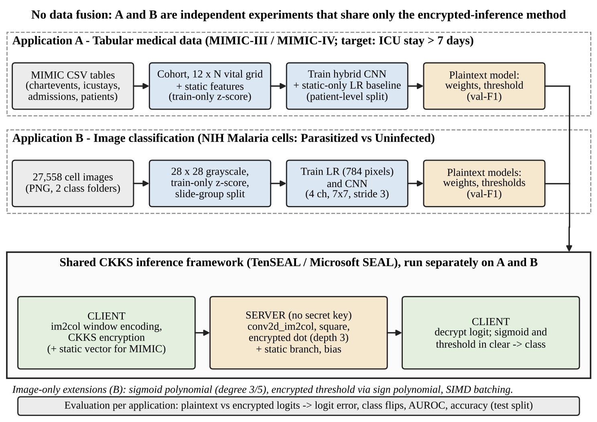

# A Unified CKKS-Based Privacy-Preserving Inference Framework Evaluated on Tabular Medical and Image Classification Tasks

Codebase and experimental reproduction suite for the minor project report:  
**"A Unified CKKS-Based Privacy-Preserving Inference Framework Evaluated on Tabular Medical and Image Classification Tasks"**  
Author: **Sharad Gupta** (National Institute of Technology Uttarakhand, BT24CSE030, November 2026).  
Full reference document: [`docs/report.pdf`](docs/report.pdf).

---

## Abstract

Machine-learning inference on sensitive medical data requires that neither the patient's record nor the prediction is exposed to the party hosting the model. Homomorphic encryption makes this possible, but replaces non-linear layers with polynomial approximations and yields approximate numerical results. This project develops a unified depth-three, square-activation client–server inference pipeline under the CKKS scheme (Cheon-Kim-Kim-Song) using TenSEAL and Microsoft SEAL. The exact same cryptographic inference procedure is evaluated across two completely independent modalities without data fusion:
1. **Clinical Tabular Time-Series**: In-hospital length-of-stay (LOS > 7 days) prediction on MIMIC-III (22,536 stays) and MIMIC-IV (35,794 stays) using hybrid 2D-convolution grids ($12 \times 10$ and $12 \times 5$) plus static feature branches.
2. **Pathology Cell Images**: Single-cell malaria parasite detection on 27,558 Giemsa-stained thin blood smear images from NIH using a 457-parameter convolutional neural network and logistic regression.

The server operates strictly over ciphertexts without access to decryption keys. Decryption occurs only at the client, which applies exact thresholding or decrypts sign-polynomial threshold approximations.

---

## Architecture

Two independent domain pipelines share a single, unified cryptographic inference engine (`common/`):

```
       +--------------------------------------------------------------+
       |                     CLIENT ENVIRONMENT                       |
       |  Raw Features / Images ---> im2col Encoding ---> Encrypt     |
       +--------------------------------------------------------------+
                                      |
                           [Ciphertext Transmission]
                                      v
       +--------------------------------------------------------------+
       |                     SERVER ENVIRONMENT                       |
       |                   (Zero Plaintext Access)                    |
       |                                                              |
       |    [Ciphertext] ---> Encrypted 2D Conv (ct-pt mul & add)     |
       |                             |                                |
       |                             v                                |
       |                  Square Activation (ct-ct mul)               |
       |                             |                                |
       |                             v                                |
       |                  Linear Readout / Dot (ct-pt dot)            |
       |                             |                                |
       |    [Optional: Encrypted Sign Polynomial Iterations]          |
       +--------------------------------------------------------------+
                                      |
                        [Decrypted Result Payload]
                                      v
       +--------------------------------------------------------------+
       |                     CLIENT ENVIRONMENT                       |
       |  Decrypted Logit / Saturated Decision <--- Decrypt with SK   |
       +--------------------------------------------------------------+
```



---

## Verified Results from the Report

### 1. Model Quality & Plaintext vs. Encrypted Fidelity (Test Split)

| Modality & Configuration | Model Architecture | Parameters | Plaintext AUROC | CKKS Encrypted AUROC (Precise) | Plaintext Accuracy | CKKS Encrypted Accuracy | Test Decision Flips (Precise) | Test Decision Flips (Standard) |
|---|---|---|---|---|---|---|---|---|
| **MIMIC-IV ($12 \times 10$)** | Hybrid CNN (4 ch, square) + static | 198 | **0.7852** | **0.7852** | 74.99% | 74.99% | **0** | 12 (0.22%) |
| **MIMIC-IV ($12 \times 5$)** | Hybrid CNN (4 ch, square) + static | 138 | 0.7049 | 0.7049 | 63.31% | 63.31% | **0** | 7 (0.13%) |
| **MIMIC-IV (Static Baseline)**| Logistic Regression (32 static) | 33 | 0.6569 | - | - | - | - | - |
| **MIMIC-III ($12 \times 10$)**| Hybrid CNN (4 ch, square) + static | 181 | 0.6924 | 0.6924 | 57.51% | 57.51% | **0** | 8 (0.24%) |
| **MIMIC-III ($12 \times 5$)** | Hybrid CNN (4 ch, square) + static | 121 | 0.6417 | 0.6417 | 57.69% | 57.69% | **0** | 8 (0.24%) |
| **MIMIC-III (Static Baseline)**| Logistic Regression (15 static) | 16 | 0.6037 | - | - | - | - | - |
| **NIH Malaria ($28 \times 28$)** | CNN (4 ch, $7 \times 7$, stride 3) | **457** | **0.8569** | **0.8569** | **77.79%** | **77.79%** | **0** | 3 (0.07%) |
| **NIH Malaria ($28 \times 28$)** | Logistic Regression (pixels) | 785 | 0.8066 | 0.8066 | 67.64% | 67.64% | **0** | 0 |

### 2. Polynomial Sigmoid Approximation vs. Noise (Malaria LR, Test Split)

| Sigmoid Method | CKKS Preset | Test Plain $\to$ Enc Accuracy | Uncalibrated Test Flips | Calibrated Test Flips | All 27,558 Flips (Calibrated) |
|---|---|---|---|---|---|
| **Exact Sigmoid** | Precise ($N=16384$) | 0.6764 $\to$ 0.6764 | 0 | 0 | 0 |
| **Degree-3 Polynomial** | Standard ($N=8192$) | 0.6764 $\to$ 0.6440 (0.6776 cal.) | 236 | **7** | 46 |
| **Degree-5 Polynomial** | Precise ($N=16384$) | 0.6764 $\to$ 0.6629 (0.6764 cal.) | 97 | **0** | **0** |

### 3. SIMD Batching and Encrypted Sign-Polynomial Thresholding

- **SIMD Feature-Major Batching**: Packs 4,096 images per ciphertext without rotations, achieving **4.5 ms wall-clock time per image** (7.8 ms CPU time, 0.068 MB upload) with **0 flips**.
- **Encrypted Decision Threshold ($f(x) = 1.5x - 0.5x^3$)**:
  - *Per-patient (max scale, 4,079 test images)*: 0 flips, 0 overflow, 0.1% saturation.
  - *Batched ($p_{99}$ scale, all 27,558 images)*: 30 flips, 54 overflow, 4.8% saturation.
  - *Batched ($p_{95}$ scale, all 27,558 images)*: 117 flips, 281 overflow, 19.5% saturation.

---

## Repository Layout

```
ckks-private-inference/
├── common/                               # Core shared cryptographic & evaluation modules
│   ├── __init__.py                       # Unified package exports and backward-compatible shims
│   ├── ckks_context.py                   # Parameter presets (standard, precise, deep, deeper)
│   ├── encrypted_inference.py            # im2col conv, square, dot, poly sigmoid, sign threshold
│   ├── metrics.py                        # AUROC, accuracy, logit error, class flips
│   └── utils.py                          # Multiprocessing chunk runner, seeding, math helpers
├── demo/
│   └── toy_demo.py                       # Self-contained smoke test (runs without any dataset)
├── tabular_mimic/                        # Clinical ICU Time-Series application (MIMIC-III / IV)
│   ├── 10_extract_timeseries.py          # Cohort extraction, 12xN grid creation, static features
│   ├── 11_train_cnn.py                   # Hybrid CNN + static LR baseline training
│   ├── 12_ckks_cnn_inference.py          # Full-cohort chunked CKKS inference
│   ├── 13_make_summary.py                # Table generation and Markdown summaries
│   ├── 15_grid_experiment.py             # Re-usable multi-grid experiment runner
│   ├── config.py                         # Single configuration entrypoint for tabular tasks
│   ├── models/                           # Exported plaintext weights (.json, no patient data)
│   └── reports/                          # Verified JSON/CSV reports from project runs
├── image_malaria/                        # Pathology Image application (NIH Malaria 28x28)
│   ├── 10_prepare_data.py                # Resizing, normalization, slide-level split (70/15/15)
│   ├── 11_train.py                       # LR and 457-parameter CNN training
│   ├── 12_ckks_inference.py              # Per-patient encrypted inference
│   ├── 13_make_summary.py                # Aggregate table builder
│   ├── 14_ckks_threshold.py              # Polynomial sigmoid & encrypted thresholding
│   ├── 15_ckks_batch.py                  # SIMD batching (4096 / 8192 images/ciphertext)
│   ├── check_gpu.py                      # CUDA/GPU diagnostics
│   ├── config.py                         # Image configuration entrypoint
│   ├── models/                           # Exported model weights (.json)
│   └── reports/                          # Verified JSON/CSV reports from project runs
├── results/                              # Consolidated summary CSVs and reports
│   ├── tabular_summary.csv
│   ├── tabular_SUMMARY.md
│   ├── image_summary.csv
│   └── image_SUMMARY.md
├── docs/                                 # Architectural diagrams and full minor report PDF
│   ├── fig1_arch.png
│   ├── fig2_flow.png
│   └── report.pdf
├── data/
│   └── README.md                         # Detailed access instructions for MIMIC & NIH datasets
├── .gitignore                            # Comprehensive exclusions for PhysioNet DUA compliance
├── requirements.txt                      # Pinned production dependency versions
└── LICENSE                               # MIT License
```

---

## Hardware & Environment Setup

### Environment Specifications
- **Operating System**: Microsoft Windows 11 Home Single Language (64-bit, Build 26300)
- **CPU**: AMD Ryzen 7 260 w/ Radeon 780M (8 Physical Cores, 16 Logical Processors)
- **System Memory (RAM)**: 24.0 GB visible physical memory
- **Python Version**: Python 3.12.7

### Pinned Dependencies (`requirements.txt`)
```
tenseal==0.3.17
torch==2.12.0
torchvision==0.27.0
scikit-learn==1.9.0
numpy==2.4.4
pandas==3.0.5
duckdb==2.0.1
pillow==12.2.0
scipy==1.17.1
```

### Installation
```bash
# 1. Create and activate a clean virtual environment
python -m venv .venv
# Windows PowerShell:
.venv\Scripts\Activate.ps1
# Linux / macOS:
source .venv/bin/activate

# 2. Install validated dependencies
pip install -r requirements.txt
```

---

## Step-by-Step Reproduction Guide

### 1. Instant Smoke Test (No Datasets Needed)
Run the self-contained demonstration script to verify TenSEAL and CKKS operations:
```bash
python demo/toy_demo.py --n 20
```
This initializes a tiny square-activation CNN, encrypts 20 random samples, and prints logit error and class-flip statistics for `standard`, `precise`, and SIMD-batched executions.

---

### 2. Tabular Pipeline (MIMIC-III and MIMIC-IV)
*(Ensure raw CSV files are placed according to [`data/README.md`](data/README.md))*

```bash
cd tabular_mimic

# Step 10: Extract cohort, build 12x10 grid and static features
python 10_extract_timeseries.py --dataset mimic4 --vitals 10

# Step 11: Train the Hybrid CNN and static LR baseline
python 11_train_cnn.py --dataset mimic4 --vitals 10 --epochs 60

# Step 12: Run encrypted CKKS inference (precise preset, multi-threaded)
python 12_ckks_cnn_inference.py --preset precise --workers 8 --split all

# Step 13: Compile summary tables
python 13_make_summary.py
```
*To evaluate other configurations (e.g., MIMIC-IV 12x5, MIMIC-III 12x10, MIMIC-III 12x5), pass `--dataset mimic3 --vitals 5` or adjust environment variables (`MIMIC_DATASET=mimic3 N_VITALS=5`).*

---

### 3. Image Pipeline (NIH Malaria 28x28)
*(Ensure cell images are placed according to [`data/README.md`](data/README.md))*

```bash
cd image_malaria

# Step 10: Preprocess and resize cell images to 28x28 grayscale
python 10_prepare_data.py

# Step 11: Train 457-parameter CNN and Logistic Regression
python 11_train.py

# Step 12: Run encrypted inference (precise preset)
python 12_ckks_inference.py --model cnn --preset precise --workers 8 --split all

# Step 14: Encrypted sign-polynomial thresholding
python 14_ckks_threshold.py --model cnn --preset deep --scale-pct 100

# Step 15: High-throughput SIMD batching
python 15_ckks_batch.py --model cnn --preset standard --batch 4096

# Step 13: Build summary report
python 13_make_summary.py
```

---

## Limitations

As detailed in Chapter 6 of the project report:
1. **Single Random Seed**: All reported training runs use fixed random seed `42`; confidence intervals across multi-seed runs were outside the computational budget of the project.
2. **Grayscale $28 \times 28$ Image Geometry**: Images are downsampled to $28 \times 28$ grayscale so that 64 sliding windows ($8 \times 8$) of 49 elements fit into a single ciphertext with power-of-two slot alignment ($4,096$ slots).
3. **MIMIC Vital Coverage Divergence**: MIMIC-III chart events exhibit lower vital coverage (e.g., blood pressure coverage of 39% vs. 100% in MIMIC-IV), explaining why MIMIC-III CNN performance is lower (0.6924 vs. 0.7852).
4. **Information Leakage in Encrypted Thresholds**: Saturated outputs hide individual scores, but unsaturated outputs remain monotone with respect to the input logit.
5. **Data Protection**: Patient-level records and raw image archives are not redistributed; pre-computed aggregate JSON summaries are provided to enable immediate result verification.

---

## References

1. Cheon, J. H., Kim, A., Kim, M., & Song, Y. (2017). Homomorphic encryption for arithmetic of approximate numbers. *ASIACRYPT 2017*, LNCS 10624, pp. 409–437.
2. Microsoft SEAL (release 4.1). [https://github.com/microsoft/SEAL](https://github.com/microsoft/SEAL).
3. Benaissa, A., Retraint, F., Moufti, B., & Akremi, M. A. (2021). TenSEAL: A library for encrypted tensor operations using homomorphic encryption. *arXiv:2104.03152*.
4. Gilad-Bachrach, R., Dowlin, N., Laine, K., Lauter, K., Naehrig, M., & Wernsing, J. (2016). CryptoNets: Applying neural networks to encrypted data with high throughput and accuracy. *ICML 2016*.
5. Johnson, A. E. W., et al. (2016). MIMIC-III, a freely accessible critical care database. *Scientific Data*, 3, 160035.
6. Johnson, A. E. W., et al. (2023). MIMIC-IV, a freely accessible electronic health record dataset. *Scientific Data*, 10, 1.
7. Rajaraman, S., et al. (2018). Pre-trained convolutional neural networks as feature extractors toward improved malaria parasite detection in thin blood smear images. *PeerJ*, 6, e4568.

---

## License

This project is licensed under the [MIT License](LICENSE).
MIMIC-III and MIMIC-IV databases are governed by the PhysioNet Credentialed Data Use Agreement. The NIH Malaria dataset is provided in the public domain by the National Library of Medicine.
